# Pruebas técnicas de Docker – Entrega 1

## 1. Objetivo

Validar el funcionamiento de la solución desarrollada con Docker Compose, integrada por dos contenedores: una API REST Flask (Python) y una base de datos PostgreSQL.

Las pruebas buscan demostrar que los servicios se ejecutan correctamente, pueden comunicarse entre sí, permiten almacenar y consultar información y conservan los datos después de reiniciar los contenedores.

## 2. Entorno de pruebas

- Proyecto: Integración Continua – Entrega 1, Escenario 3.
- Institución: Politécnico Grancolombiano.
- Repositorio: https://github.com/AndersonMolano/docker-contenedores
- Sistema anfitrión: Windows.
- Herramientas: Docker Desktop, Docker Compose, Git y Visual Studio Code.
- Docker Engine: Linux mediante WSL2.
- API: Flask, Python 3.12.
- Base de datos: PostgreSQL 16.
- Rama de trabajo: `mejora-documentacion-pruebas`.

## 3. Pruebas realizadas

| ID | Prueba | Comando | Resultado |
|---|---|---|---|
| P01 | Validación de configuración | `docker compose config --quiet` | Aprobada |
| P02 | Construcción de imagen Flask | `docker compose build api` | Aprobada |
| P03 | Inicio de servicios | `docker compose up -d` | Aprobada |
| P04 | Estado de contenedores | `docker compose ps` | Aprobada |
| P05 | Comunicación Flask–PostgreSQL | `GET /health` | Aprobada |
| P06 | Escritura de información | `POST /notas` | Aprobada |
| P07 | Lectura de información | `GET /notas` | Aprobada |
| P08 | Persistencia de datos | `docker compose down`, `docker compose up -d` y `GET /notas` | Aprobada |
| P09 | Inspección de red Docker | `docker network inspect docker-contenedores_red_proyecto` | Aprobada |
| P10 | Ejecución del pipeline CI | `Workflow GitHub Actions Docker build` | Aprobada |

## 4. Resultados obtenidos

### P01. Validación de Docker Compose

Comando:

`docker compose config --quiet`

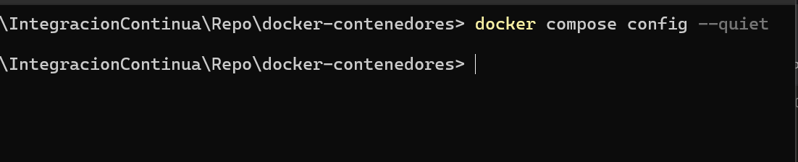

Resultado: el comando finalizó sin mostrar errores ni advertencias.

### P02. Construcción de la imagen Flask

Comando:

`docker compose build api`

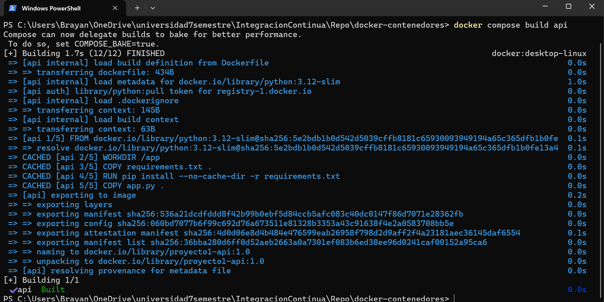

Resultado: Docker construyó correctamente la imagen `proyecto1-api:1.0`.

### P03 y P04. Inicio y estado de los servicios

Comandos:

`docker compose up -d`

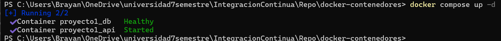  

 

`docker compose ps`

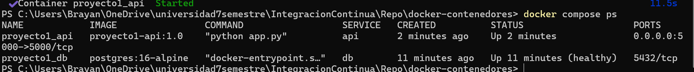
 
 

Resultados:

- `proyecto1_api`: Up.
- `proyecto1_db`: Up (healthy).
- Puerto de Flask: 5000.
- Puerto interno de PostgreSQL: 5432.

### P05. Comunicación Flask–PostgreSQL

Comando de PowerShell:

`Invoke-RestMethod -Uri "http://localhost:5000/health" -Method Get`

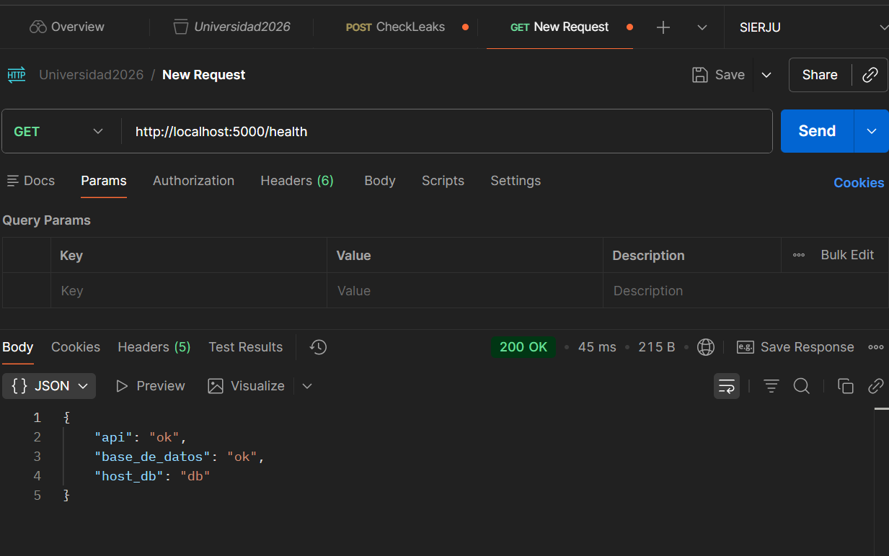

Resultado:

- `api`: ok.
- `base_de_datos`: ok.
- `host_db`: db.

Esto demuestra que la API pudo consultar PostgreSQL mediante el nombre de servicio `db`.

### P06. Escritura en PostgreSQL

Comando de PowerShell:

`Invoke-RestMethod -Uri "http://localhost:5000/notas" -Method Post -ContentType "application/json" -Body '{"texto":"Prueba de integracion continua realizada desde mi rama"}'`

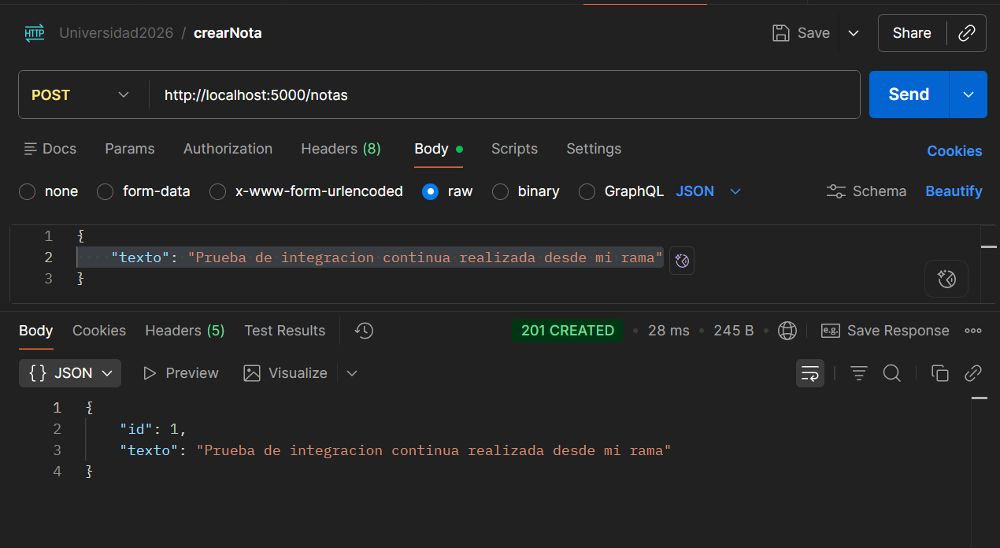

Resultado:

- ID asignado: 1.
- Texto almacenado: Prueba de integracion continua realizada desde mi rama.

### P07. Lectura desde PostgreSQL

Comando:

`Invoke-RestMethod -Uri "http://localhost:5000/notas" -Method Get`

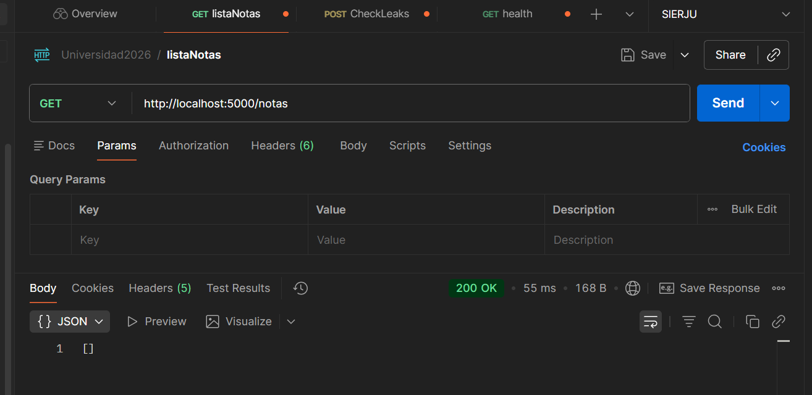  

Resultado: la API recuperó la nota previamente almacenada, con identificador 1 y su fecha de creación.

### P08. Persistencia de información

Se ejecutaron los siguientes comandos:

1. `docker compose down`
2. `docker compose up -d`
3. `Invoke-RestMethod -Uri "http://localhost:5000/notas" -Method Get`

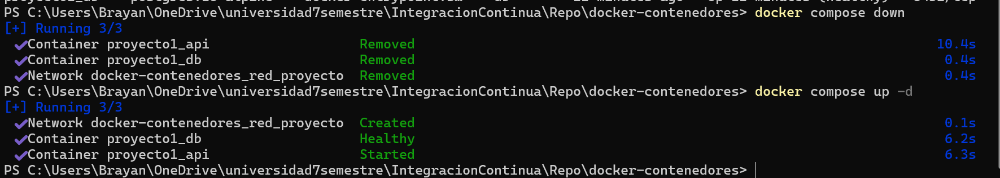  

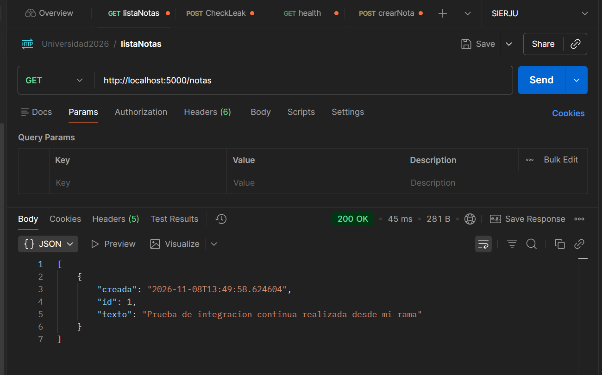  

Resultado: la nota con identificador 1 permaneció disponible y conservó su fecha de creación.

Esto evidencia el funcionamiento del volumen persistente de PostgreSQL.

**Precaución:** no ejecutar `docker compose down -v` durante esta prueba, porque elimina los volúmenes del proyecto.

### P09. Inspección de la red Docker

Comando:

`docker network inspect docker-contenedores_red_proyecto`

Resultado:

- Red: `docker-contenedores_red_proyecto`.
- Controlador: `bridge`.
- Contenedor Flask: `proyecto1_api`.
- Dirección IP observada: `172.19.0.3`.
- Contenedor PostgreSQL: `proyecto1_db`.
- Dirección IP observada: `172.19.0.2`.

Las direcciones IP son dinámicas. La conexión entre servicios debe utilizar el nombre `db` y no una dirección IP fija.

### P10. Validación del pipeline de GitHub Actions

Ejecución automática del workflow "docker-build.yml" mediante el evento disparado por un pull request

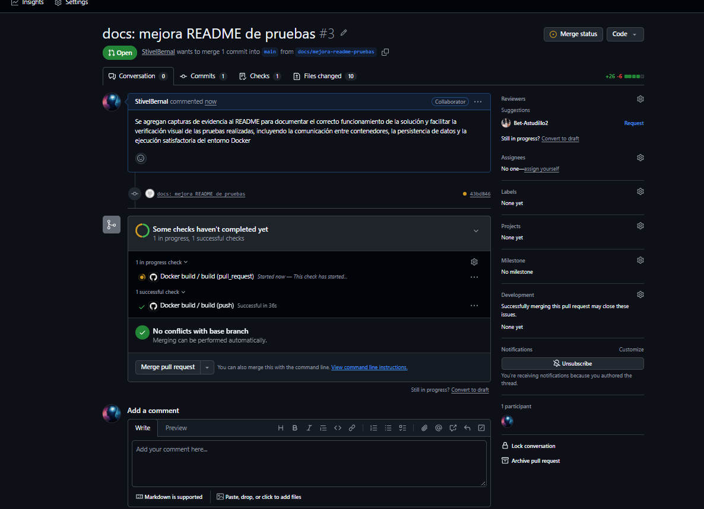  

 

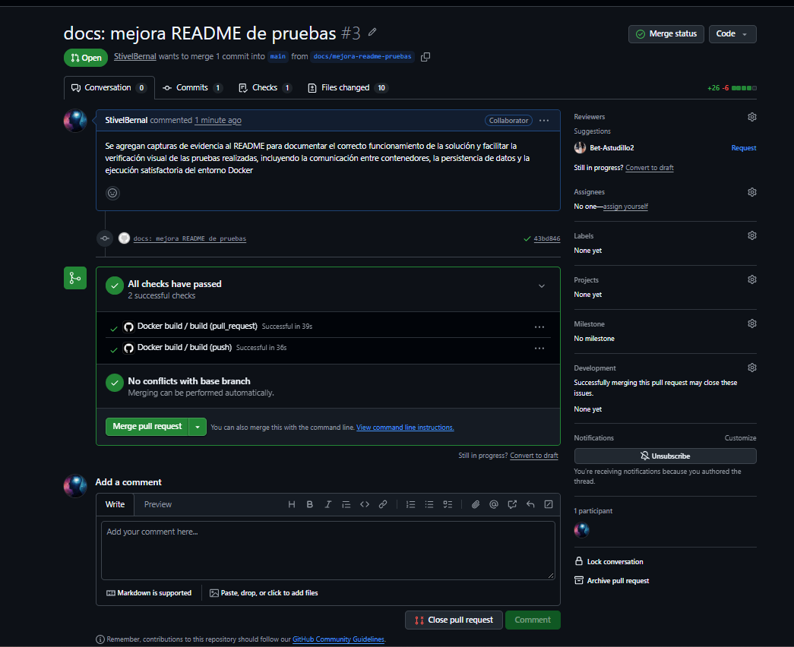  

 
Resultado:

- Descarga automática del código fuente.
- Creación de un archivo `.env` de prueba a partir de `.env.example`.
- Validación de la configuración mediante `docker compose config`.
- Construcción automática de las imágenes Docker.
- Levantamiento de los servicios con `docker compose up -d`.
- Verificación de disponibilidad de la API mediante `GET /health`.
- Prueba automática de escritura de datos mediante `POST /notas`.
- Prueba automática de lectura de datos mediante `GET /notas`.
- Apagado controlado de los servicios al finalizar la ejecución.
- Estado final del workflow: **Success**.

El pipeline garantiza que cada cambio enviado al repositorio sea validado automáticamente, verificando la construcción de la solución, la disponibilidad de los contenedores y la correcta comunicación entre la API Flask y PostgreSQL antes de integrar nuevas modificaciones.

## 5. Conclusiones

- Las diez verificaciones realizadas finalizaron satisfactoriamente.

- Se confirmó la construcción de la imagen Flask, el funcionamiento simultáneo de ambos contenedores, la comunicación con PostgreSQL, la escritura y recuperación de datos y la persistencia después de recrear los contenedores.
 
- Las pruebas locales permitieron validar la construcción de la imagen de la API, el levantamiento de los contenedores, la comunicación entre Flask y PostgreSQL, la escritura y recuperación de información, la persistencia de los datos y la correcta configuración de la red Docker.

- La ejecución satisfactoria del workflow en GitHub Actions confirmó adicionalmente que la solución puede construirse y validarse de forma automática en cada push o pull request, fortaleciendo el proceso de integración continua mediante la ejecución repetible de pruebas sobre la infraestructura Docker.

- La solución cumple el objetivo técnico de construir dos contenedores Docker comunicados entre sí.

- La combinación de pruebas locales y automáticas aporta trazabilidad, confianza en los cambios y una detección temprana de errores, principios fundamentales de la integración continua. 

## 6. Referencias

- Docker. (s. f.). Docker Compose. https://docs.docker.com/compose/
- Docker. (s. f.). Networking in Compose. https://docs.docker.com/compose/how-tos/networking/
- Docker. (s. f.). Volumes. https://docs.docker.com/engine/storage/volumes/
- GitHub. (s. f.). GitHub Actions documentation. https://docs.github.com/actions
